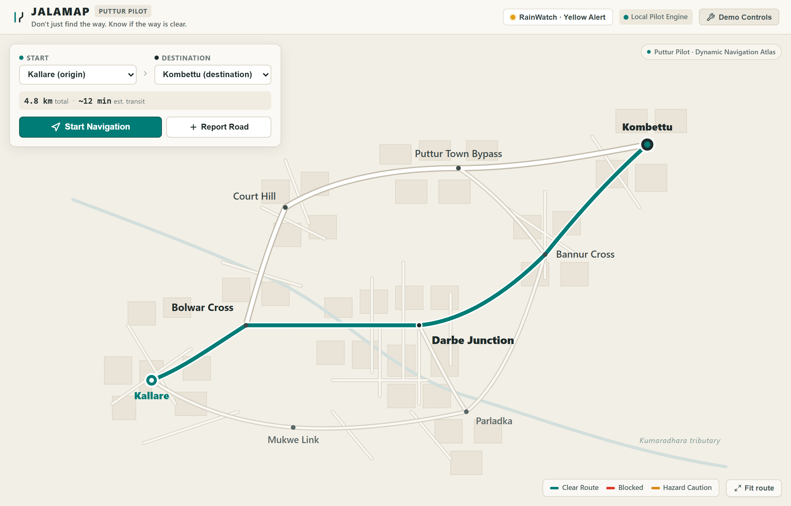
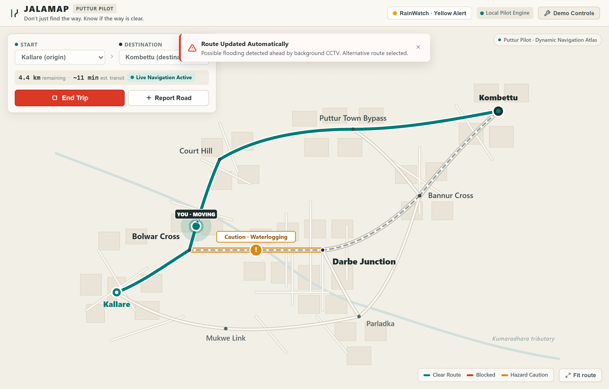

# JALAMAP V3 — Smart Monsoon Road Navigation

> **JALAMAP** is an intelligent, flood-aware road navigation application designed for monsoon commuters in **Puttur, Dakshina Kannada, Karnataka**, built for **RESURRECT 2026**.
> 
> *"Don't just find the way. Know if the way is clear."*



---

## The Core Product Philosophy

Most navigation systems assume roads are permanently open or rely on manual, cumbersome voting workflows. In a Coastal Karnataka monsoon, flash inundation and stream runoff can submerge a road approach in minutes.

**JALAMAP eliminates complex dashboards, manual voting buttons, and camera monitors for ordinary commuters.**

### The Commuter Workflow:
1. **Choose a starting point** (e.g., Kallare).
2. **Choose a destination** (e.g., Kombettu).
3. **Click `Start Navigation`**.

**Everything else happens automatically.**

When road conditions change ahead—whether detected by background municipal CCTV intelligence or crowdsourced community observations—JALAMAP automatically evaluates the evidence, recalculates the safest remaining route from the **commuter's current position**, and continues guiding the journey.

---

## Key Capabilities in V3

### 1. Minimal, Navigation-First Interface
- **Map-First Focus**: The cartographic atlas occupies the primary screen area with warm ivory styling (`#F2EFE6`), clear road hierarchy, building parcels, and Kumaradhara tributary.
- **Petrol Teal Route** (`#007C76`): High-contrast routing path with a pale protective halo.
- **Amber Provisional Hazards** (`#D98818`): Precautionary avoid-road warnings.
- **Coral Red Blockages** (`#DC3826`): Confirmed impassable road closures with hazard barrier stripes.
- **Removed Clutter**: Removed technical state cards, Rider A/B switcher buttons, manual "Confirm Blockage" prompts, and CCTV viewer screens from the commuter interface.

### 2. Background CCTV Intelligence
- **Strictly Behind the Scenes**: Commuters are **never** shown surveillance footage, camera feeds, or manual inspection controls.
- **Automated Hazard Ingestion**: Registered municipal cameras (`CAM-01` at Darbe, `CAM-02` at Bannur, etc.) feed a background detection adapter.
- **Automated Route Update**: A high-confidence waterlogging detection automatically applies a provisional road restriction, re-evaluates active commuter routes, and recalculates alternatives from the vehicle's live position with a nonintrusive alert:  
  *“Possible flooding detected ahead by background CCTV. Alternative route selected.”*

### 3. Community Reporting (Zero Manual Confirmation Buttons)
- Commuters simply tap **`+ Report Road`**.
- Select the condition: **Road Blocked**, **Partially Blocked**, **Road Passable**, or **Not Sure**.
- Tap **Submit Report**.
- The evidence engine clusters submissions, weeds out duplicate votes from the same user, accounts for report freshness, and automatically updates road restrictions and active navigation routes.

### 4. Unlimited-Contributor Data Model
- **No 2-Rider Limit**: Replaces the hardcoded Rider A/Rider B limit with an open contributor architecture supporting an arbitrary number of users (3, 20, 50, 100+).
- **Independent Identity Governance**: Unique user identity tracking ensures duplicate submissions by one user do not artificially inflate restriction counts.
- **Freshness Decay**: Older reports (> 45 minutes) decay as monsoon floodwaters shift.

### 5. Continuous Mid-Journey Rerouting
- **Current-Position Departure**: When a hazard appears ahead, JALAMAP reroutes from the commuter's **current coordinates and heading**, never restarting from the original starting point.
- **Behind-the-User Protection**: Restrictions on roads behind the commuter or on unrelated corridors do not trigger unnecessary route recalculations.
- **Automatic Reopening**: When fresh credible evidence (3 passable reports or CCTV clearance) confirms water has receded, the road reopens in the graph and the journey restores to the optimal route.

---

## Demonstration Scenarios (Simulation Studio)

For hackathon judges and technical evaluators, demo controls are housed in a collapsible **Simulation Studio** drawer (toggle via `Demo Controls` in the header).

| Scenario | Title | Description |
| :--- | :--- | :--- |
| **Scenario 1** | **Normal Journey** | Commute Kallare → Kombettu (4.8 km via Darbe). Starts journey and begins moving the vehicle. |
| **Scenario 2** | **Mid-Journey CCTV Hazard** | Advances vehicle toward Bolwar, triggers background CCTV waterlogging at Darbe. Reroutes automatically from CURRENT position via Town Bypass (no camera footage shown). |
| **Scenario 3** | **Community Consensus** | Simulates 3 distinct independent community reports on Darbe–Bannur. Automatically evaluated; road restricted; routes updated. |
| **Scenario 4** | **Automatic Reopening** | Simulates 3 distinct passable reports and sustained CCTV clearance. Reopens road and restores optimal path. |
| **Scenario 5** | **Sequential Blockages** | Triggers a second blockage ahead while navigating the detour. Recalculates tertiary route from live location. |
| **Scale Test** | **100 Contributors** | Fires 3, 20, or 100 simulated distinct contributors to verify the unlimited-contributor data model. |



---

## Technical Transparency: What Works vs. What Is Simulated

In adherence to RESURRECT 2026 integrity guidelines:

| Feature | Implementation Status | Notes |
| :--- | :--- | :--- |
| **Dijkstra Shortest Path Engine** | **Genuinely Works** | Dynamic edge weighting, penalty multipliers, and SVG bezier geometry interpolation execute in client TypeScript. |
| **Continuous Dynamic Rerouting** | **Genuinely Works** | Evaluates remaining segments ahead, computes new path from vehicle coordinates, updates distance and ETA dynamically. |
| **Multi-Contributor Evidence Engine** | **Genuinely Works** | Independent contributor grouping, duplicate filtering, decay windows, and consensus evaluation execute in real-time. |
| **Background CCTV Pipeline** | **Telemetry Simulated** | The event pipeline, subscription model, and route triggers are genuine. Computer vision video processing is deterministic simulated telemetry labeled with `isDemonstration: true`. |
| **Vehicle Progression** | **Controlled Simulation** | Vehicle moves smoothly along cubic bezier curves of the Puttur road network. (Real GPS requires live physical movement in Puttur). |
| **Cross-Device Shared Backend** | **Schema Ready & Configurable** | Complete PostgreSQL/Supabase schema, RLS policies, and SQL triggers are provided in `supabase/migrations/001_jalamap_schema.sql`. Operates in local reactive mode if Supabase keys are not set. |
| **RainWatch Weather** | **Contextual Simulation** | Displays realistic monsoon hydromet risk for Puttur, Dakshina Kannada. IMD integration endpoint documented in `.env.example`. |

---

## Quick Start

### 1. Install Dependencies
```bash
npm install
```

### 2. Run Automated Verification Tests
```bash
npm test
```
*Executes all 20 Phase 13 verification tests including routing, multi-contributor scaling, CCTV ingestion, duplicate prevention, and reopening logic.*

### 3. Start Development Server
```bash
npm run dev
```
Open [http://localhost:5173](http://localhost:5173) in your browser.

### 4. Build for Production
```bash
npm run build
npm run preview
```

---

## Architecture Overview

```
Commuter UI: Start Navigation & Report Road
     │
     ├──> Local / Geolocation Position Tracking
     │
Central Event Engine & Database Service (src/services/database.ts)
     ▲                                   ▲
     │                                   │
Background CCTV Service             Crowdsourced Reports
(src/services/cctvService.ts)       (src/components/ReportModal.tsx)
     │                                   │
     └───────────────┬───────────────────┘
                     ▼
       Evidence Evaluation Engine (src/utils/evidenceEngine.ts)
       - Deduplication by User ID
       - Temporal Freshness Window (45 min)
       - Multi-Contributor Thresholds (>= 3 reports)
                     │
                     ▼
       Authoritative Road Restrictions
                     │
                     ▼
       Dynamic Routing Engine (src/utils/routing.ts)
       - Recalculates from Current Vehicle Position
       - Avoids Confirmed Blockages (Infinity penalty)
       - Penalizes Provisional Hazards (6x penalty)
                     │
                     ▼
       Map Atlas Viewport & Alert HUD
```

---

## Database Migrations (Supabase / PostgreSQL)

If connecting a shared Supabase instance:
1. Copy `.env.example` to `.env.local` and add your `VITE_SUPABASE_URL` and `VITE_SUPABASE_ANON_KEY`.
2. Apply the migration file:
   ```bash
   supabase db push
   # or execute supabase/migrations/001_jalamap_schema.sql in the Supabase SQL Editor
   ```
3. Realtime subscriptions will synchronize road restrictions across all devices.

---

## License & Attribution

Developed for **RESURRECT 2026** — VVEC Hackathon.  
Pilot Area: Puttur, Dakshina Kannada, Karnataka.
