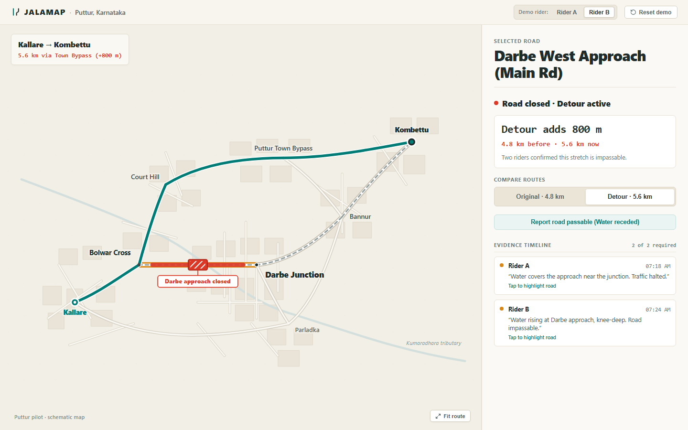

# JALAMAP · Monsoon Street Atlas

> **JALAMAP** is a community road-condition prototype designed for monsoon-affected commutes in Puttur, Dakshina Kannada, Karnataka. Built for **RESURRECT 2026**, it answers the critical commuter question:  
> *“A message says there's water near Darbe — which road does that mean, when was it reported, and does my route change?”*



---

## Cartographic Art Direction

JALAMAP is styled as a printed street atlas brought to life:
- **Warm paper ground** (`#F2EFE6`) with subtle urban settlement blocks in sand and stone tones.
- **Street network hierarchy** with realistic road widths, ivory fills, and casings that merge into authentic road intersections rather than abstract graph nodes.
- **Saturated petrol teal route** (`#007C76`) delivering high contrast across projector screens.
- **Vermilion closure barrier** (`#DC3826`) and direct leader line indicating the exact affected approach at Darbe Junction.
- **Working Route Comparison**: Interactive segmented buttons (`[ Original · 4.8 km ]` vs `[ Detour · 5.6 km ]`) allowing judges and commuters to visually compare paths before and after closure.

---

## What It Demonstrates

1. **State A — Initial Journey**: Opens directly on an active morning commute from **Kallare Gateway** to **Kombettu Hub** via Darbe Junction (4.8 km).
2. **State B — One Observation**: Rider A reports water at the Darbe West Approach. An amber beacon and leader callout flag the road (`▲ Darbe approach: 1 report`); the route remains unchanged awaiting independent confirmation.
3. **State C — Confirmed Detour**: Rider B independently confirms the blockage. Two matching observations trigger consensus. The Darbe Approach closes with a vermilion barrier, the former route becomes a muted dashed line, and the new detour draws via North Town Bypass (`5.6 km`, `+800 m detour`).
4. **Route Comparison**: Commuters can toggle between the historical path before closure (`Original · 4.8 km`) and the active detour (`Detour · 5.6 km`).
5. **State D — Verified Reopening**: When two riders observe water receding, the direct shorter route is restored, preserving the full chronological evidence timeline.

*Note on pilot data*: This prototype uses an offline schematic road network of the Puttur pilot area and simulated commuter identities (Rider A & Rider B) to demonstrate consensus rules under intermittent connectivity.

---

## Quick Start

### Prerequisites
- Node.js (v18+ recommended, verified on Node v24)
- npm

### 1. Install Dependencies
```bash
npm install
```

### 2. Start Local Development Server
```bash
npm run dev
```
Open [http://localhost:5173](http://localhost:5173) in your browser.

### 3. Production Build & Preview
```bash
npm run build
npm run preview
```

---

## Role of CCTV Camera Evidence (Pitch Slide 8)

When a commuter reports flooding near a junction, words like *“near Darbe”* leave a critical operational question: *can we see the exact stretch of road the rider is talking about?*

JALAMAP introduces a municipal road-camera review workflow that provides immediate visual corroboration while upholding decentralized community trust:
- **Exact-Segment Verification**: Camera records are bound directly to road-segment IDs (e.g. `CAM-01` covers `seg_bolwar_darbe`). A camera facing a different approach to the same junction is a different view and will never substitute.
- **Configurable Temporal Matching Window**: Road frames are only matched if captured within a **10-minute demo window** (`CAMERA_FRAME_WINDOW_MINUTES = 10`) of the rider report. Stale frames are flagged explicitly with their capture time (e.g. *“No frame close to the report time (captured 07:45 IST · 29 min before report)”*), and roads without cameras display *“No camera covers this stretch”*.
- **Strict Consensus Governance (Supporting Evidence Only)**: Camera observations provide visual ground truth (e.g., *“Water visible on the road”*, *“View obstructed”*), but **never cast a consensus vote**. The **two-rider rule strictly controls closure and reopening**. An incident with 1 rider report and 1 camera observation remains in `Waiting for a second rider` status with the original route active until an independent second commuter confirms.
- **Asset Attribution**: Camera views in this prototype are project-created high-fidelity illustrative vector stills (`public/assets/cctv/cam-01-darbe-west.png`, `.svg`) depicting an authentic Coastal Karnataka monsoon corridor with curb-to-curb water accumulation, labeled with permanent `Recorded demo frame` and `Illustrative camera view` disclosures.

---

## Try the Demo (35-Second Walkthrough)

Follow these exact button steps in the running prototype:

1. **Open the App**: Observe the active commute line (`4.8 km via Darbe`) routed directly through Darbe Junction.
2. **Click `Report a blockage`**: Rider A records high water on *Darbe West Approach* at `08:14 IST`. The status updates to `Waiting for a second rider` with an amber beacon on the map.
3. **Inspect the Road Camera Section**: Notice the compact `Road camera` card appears under supporting evidence with thumbnail `CAM-01`, road name, and capture time `08:12 IST · 2 minutes before the report`.
4. **Click `Review camera frame`**: Opens the camera frame inspector in the workspace. Notice the map highlights Darbe West Approach and displays a directional camera marker (`CAM-01`) pointing East toward Darbe Junction.
5. **Select an Observation & Attach**: Under *“What can you see?”*, select `Water visible on the road` and click `Attach observation`. The observation is recorded and pinned to the incident timeline.
6. **Verify Governance Independence**: Notice the rider count remains `1 of 2 required (· 1 camera review)`, the status remains `Waiting for a second rider`, and the route remains `4.8 km via Darbe`. Camera evidence does not prematurely close the road.
7. **Click `✕` to Close Review**: The incident timeline now displays both Rider A's report and `Camera observation · CAM-01`.
8. **Switch to Rider B & Confirm**: Click `Switch to Rider B (Independent witness) →`, then click `Confirm blockage`. Two independent riders confirm consensus: Darbe West Approach closes with a vermilion barrier, and the detour draws via Town Bypass (`5.6 km`, `+800 m detour`).
9. **Reopen Camera Observation After Detour**: In the Evidence Timeline, click `Camera observation · CAM-01`. The review frame reopens showing the original `08:12 IST` still, capture time, and attached observation.
10. **Click `Reset demo`** (top right) at any time to clear state and reset the demonstration.

---

## Architectural Implementation & Core Files

| Concern | Source File | Description |
|---|---|---|
| **Road Network Graph** | [`src/data/putturNetwork.ts`](src/data/putturNetwork.ts) | 9 junctions, coordinates, road segment definitions, and distance weights. |
| **CCTV Camera Registry & Matching** | [`src/data/cameraData.ts`](src/data/cameraData.ts) | Camera registry (`CAM-01`, `CAM-02`), 10-minute temporal matching window, and time delta engine. |
| **Camera Review Modal** | [`src/components/CameraReviewModal.tsx`](src/components/CameraReviewModal.tsx) | Restrained desktop frame inspector and mobile bottom sheet with 4 visual observation choices. |
| **Shortest-Path Routing** | [`src/utils/routing.ts`](src/utils/routing.ts) | Dijkstra shortest-path engine excluding blocked segments and computing path geometry. |
| **Consensus Verification** | [`src/utils/verification.ts`](src/utils/verification.ts) | Two-witness consensus rule and duplicate observer rejection logic (isolated from camera reviews). |
| **Cartographic Map** | [`src/components/MapAtlas.tsx`](src/components/MapAtlas.tsx) | Warm daylight SVG street atlas with urban blocks, seamless junctions, directional camera marker, and route comparison. |
| **Incident Sheet** | [`src/components/IncidentSheet.tsx`](src/components/IncidentSheet.tsx) | Road camera card, route comparison segmented control, and chronological evidence timeline. |
| **State Persistence** | [`src/utils/storage.ts`](src/utils/storage.ts) | `localStorage` persistence surviving page refresh with dedicated demo reset. |

---

## Verified Proof Screenshots

All screenshots were captured from a standalone browser at 1440 × 900 (and 16:9 for the slide) and are located in `docs/screenshots/`:
- [`01-initial-route.png`](docs/screenshots/01-initial-route.png) — Initial 4.8 km commute through Darbe Junction.
- [`02-one-rider.png`](docs/screenshots/02-one-rider.png) — One observation by Rider A with amber beacon, awaiting verification.
- [`03-confirmed-detour.png`](docs/screenshots/03-confirmed-detour.png) — Confirmed closure with vermilion barrier, dashed former route, and 5.6 km (+800 m) detour.
- [`04-reopened.png`](docs/screenshots/04-reopened.png) — Two riders verify reopening, direct route restored, full timeline preserved.
- [`05-cctv-evidence.png`](docs/screenshots/05-cctv-evidence.png) — **CCTV evidence review on Darbe West Approach (Slide 8)**: CAM-01 frame still at 08:12 IST, temporal delta (2 min before report), attached observation *“Water visible on the road”*, directional camera marker on map, and incident awaiting independent Rider B confirmation.
- [`jalamap-route-comparison.png`](docs/screenshots/jalamap-route-comparison.png) — 16:9 presentation slide proof image with side-by-side equal-scale crops of Darbe approach in State B vs State C.
